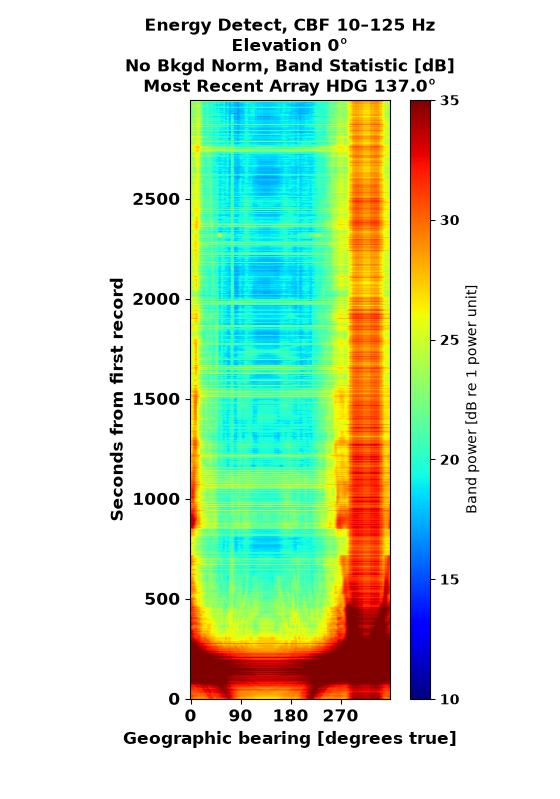
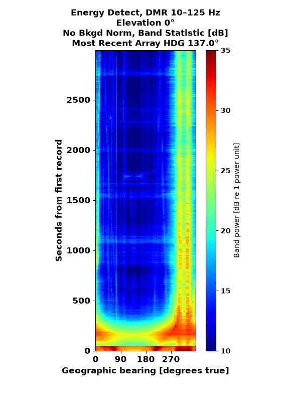
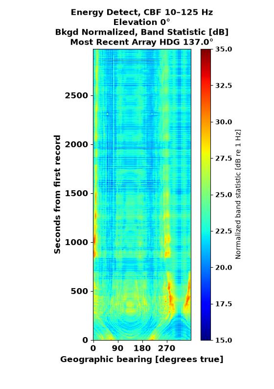
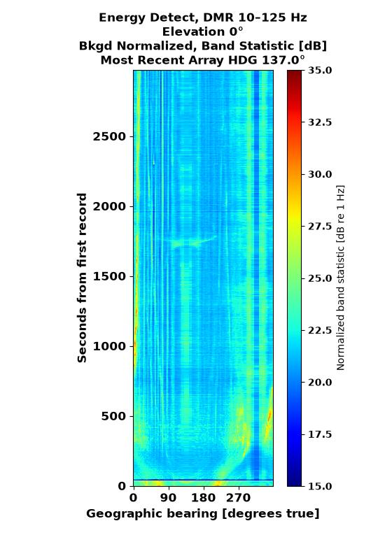
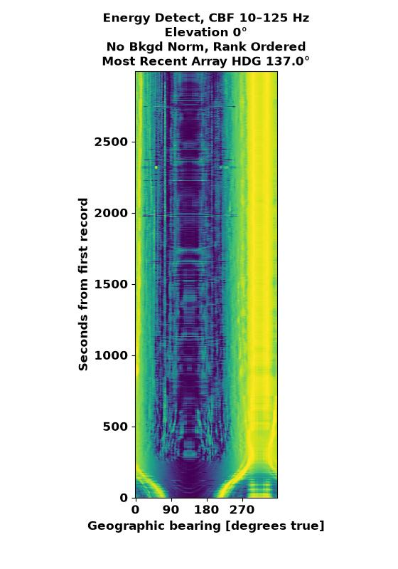
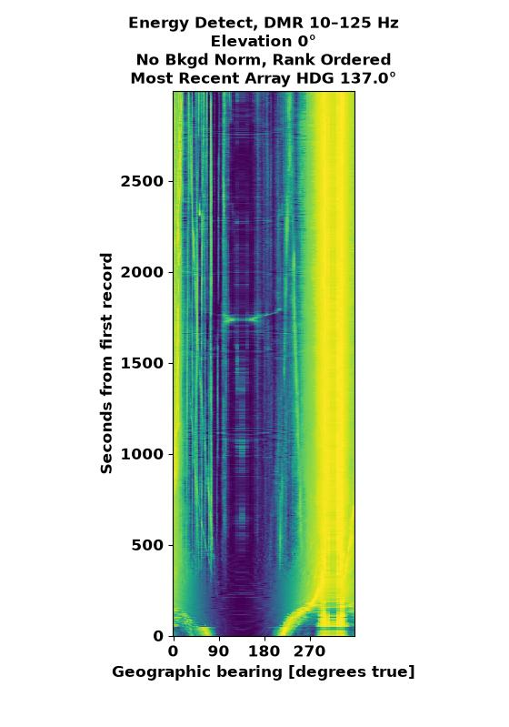
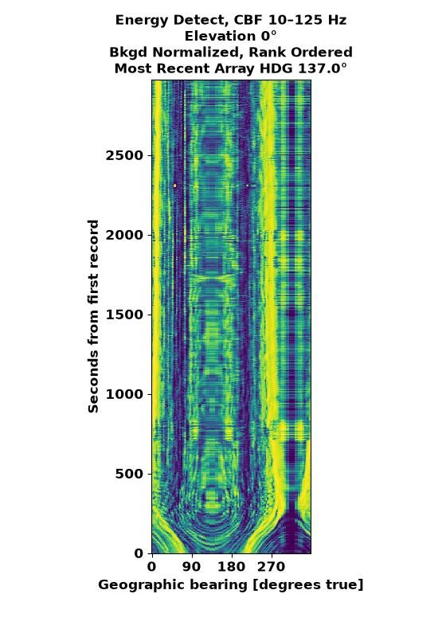
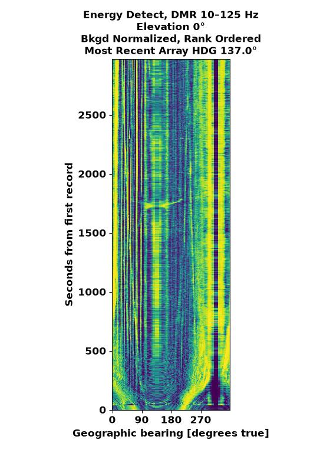

# Band-energy detection

Band-energy detection converts beam power spectral density (`bpsd`) records
into compact bearing-time records (`btr`). It integrates energy in configured
frequency bands and can optionally normalize each PSD bin by an estimated
background before integration.

The detector rationale follows the unknown-spectrum energy-detector framework
in [Abraham (2019)](../references.md#abraham-2019). In particular, Abraham's
Eq. (9.2) supports forming energy from squared Fourier magnitudes, while
Section 9.2.6.1 analyzes noise-normalized energy for an unknown spectral shape
within a known band. Its optimality statements apply under the known-noise,
independent-bin, and signal-model assumptions of the corresponding derivation;
they are not claims that WaveKernelRT's complete robust preprocessing chain is
optimal.

`BandEnergyConfig` builds the `BFtoBandEnergy_Stage`. Each input record has
shape `(Q, J)`, where `Q` is frequency and `J` is the flattened steering
direction. Each output record has shape `(B, A, E)`, where `B`, `A`, and `E`
are band, azimuth, and elevation. The current implementation supports exactly
one steering range and preserves all azimuths and elevations.

## Direct band energy

For frequency bin widths $\Delta f_q$ and an inclusive band $b$, direct
processing computes

$$
P_{b,j} = \sum_{q \in b} P_{q,j}\,\Delta f_q.
$$

Bin widths come from `numpy.gradient` on the strictly increasing frequency
grid. Every configured band must contain at least one stored frequency bin.
Bands may overlap.

Computing energy in the frequency domain is supported by Abraham (2019),
Section 9.1, p. 622, Eq. (9.2). The PSD convention and bin-width integration
used here are WaveKernelRT's numerical scaling choices.

With `output="float32"`, the stored value is

$$
L_{b,j} = 10\log_{10}\left(\max(P_{b,j}, 10^{-40})\right).
$$

This is band power in decibels relative to one input power unit. Absolute
interpretation requires calibrated input samples.

## Optional background normalization

`BackgroundEstimateConfig` enables any combination of:

- sliding time averaging in linear power,
- clip-and-replace filtering of narrow spectral peaks,
- frequency smoothing, and
- median filtering across a bearing neighborhood.

The operations run in that order, with conversion of the background estimate
to decibels before the spectral and bearing filters. The center input PSD is
then divided by the estimated background in linear power:

$$
R_{q,j} = \frac{P^{center}_{q,j}}{P^{background}_{q,j}}.
$$

Per-bin division followed by a linear sum is the statistic in Abraham (2019),
Section 9.3, p. 683, Eqs. (9.190)–(9.191). WaveKernelRT computes the
bin-width-weighted version
$\sum_{q \in b} R_{q,j}\Delta f_q$ so the operation remains a numerical
integral when bin widths differ. Because the ratio is dimensionless before
integration, float32 output is expressed in decibels relative to 1 Hz rather
than as band power.

Abraham (2019), Section 9.3.4.2, p. 697, also illustrates converting an average
of linear normalized powers to decibels. That supports the order “aggregate in
linear power, then take the logarithm,” but its unweighted mean and
WaveKernelRT's bin-width-weighted integral differ by more than a universal
scale factor when bands or frequency grids differ.

When a time window is enabled, the stage emits its first record after the
window fills. The evaluated PSD and output timestamp correspond to the middle
record; an even-length window uses the later middle record. Without time
averaging, every input record can produce an output immediately.

The estimator's individual ideas are supported in the literature, but no
single canonical reference specifies this exact combination, ordering, and
implementation:

- Abraham (2019), Section 9.3.1, p. 684, Eqs. (9.192)–(9.194), supports the
  arithmetic mean of linear auxiliary powers under an independent,
  equal-mean exponential model. This matches the implemented time-window
  arithmetic but not necessarily the dependence structure of overlapping
  records.
- Pages 683–684 motivate nearby beams as auxiliary data for persistent
  broadband backgrounds when the noise spectrum varies little with angle.
  They support the source of the bearing observations, not WaveKernelRT's
  median, neighborhood width, or edge handling.
- Pages 684–685 motivate sharing background observations across nearby
  frequencies when the noise spectrum varies slowly. They do not prescribe
  WaveKernelRT's smoothing window, reflective boundaries, or decibel-domain
  convolution.

The background estimate can be correlated across time, bearings, or frequency.
Abraham's general fixed weighted-average analysis accommodates correlated
auxiliary observations in Section 9.3.4.1, p. 693, Eqs. (9.220)–(9.222), but it
does not directly describe the data-dependent median or clip-and-replace
operations implemented here.

### Clip-and-replace filtering

Each `car_parms_WP` tuple `(side, guard, threshold_dB)` defines a normalized
frequency-axis kernel made of `side` equal-weight bins, `guard` zero-weight
bins, and another `side` equal-weight bins. For background level $x_{q,j}$ in
decibels, convolution with that guarded kernel gives the local sideband mean
$\mu_{q,j}$. The stage applies the decision

$$
y_{q,j} =
\begin{cases}
\mu_{q,j}, & x_{q,j} > \mu_{q,j} + T,\\
x_{q,j}, & \text{otherwise},
\end{cases}
$$

where $T$ is `threshold_dB`. Reflection supplies values beyond the frequency
boundaries. The central guard keeps the tested spectral peak and nearby bins
out of its reference mean. If multiple tuples are supplied, they run in list
order and each filter consumes the preceding filter's output. This permits,
for example, a narrow/low-threshold stage followed by a wider/higher-threshold
stage.

### Relationship to Hampel filtering

The clip-and-replace rule is structurally related to the Hampel decision
filter described by [Pearson et al.
(2016)](../references.md#pearson-et-al-2016): both compare the current value
with a local reference, preserve it when it passes the decision, and replace
it with the reference when it is classified as an outlier. The standard
Hampel rule is

$$
H(x_{q,j}) =
\begin{cases}
x_{q,j}, & |x_{q,j}-m_{q,j}| \le tS_{q,j},\\
m_{q,j}, & |x_{q,j}-m_{q,j}| > tS_{q,j},
\end{cases}
$$

where $m_{q,j}$ is the moving median and
$S_{q,j}=1.4826\,\operatorname{median}(|x-m_{q,j}|)$ is the local MAD scale
estimate. WaveKernelRT's rule is therefore Hampel-like, not a standard or
generalized Hampel filter:

| Property | Hampel filter | WaveKernelRT clip-and-replace |
| --- | --- | --- |
| Local reference | Median of the full window | Mean of guarded sidebands |
| Threshold | Local MAD multiplied by $t$ | Fixed decibel offset $T$ |
| Decision | Two-sided absolute deviation | Upper peaks only |
| Replacement | Local median | Guarded sideband mean |
| Multiple stages | Generalized Hampel cascades are studied in the paper | Configured stages form a sequential clip-and-replace cascade |

The bearing-neighborhood operation later in the estimator is an unconditional
median filter, corresponding to the median operation that Pearson et al.
identify as the $t=0$ limit of a standard Hampel filter. It acts across beams,
however, whereas clip-and-replace acts along frequency. Neither observation
makes the complete background estimator a generalized Hampel filter.

This distinction matters when tuning: increasing `threshold_dB` makes a
clip-and-replace stage less aggressive, much as increasing $t$ does for a
Hampel filter, but `threshold_dB` is not a robust scale multiplier and cannot
be transferred directly from a Hampel-filter design.

## Statistical interpretation and thresholds

Noise normalization is often associated with constant-false-alarm-rate
detectors, but this stage does not assign a false-alarm probability or compute
a statistically calibrated decision threshold. An unbiased background-power
estimate does not by itself make the ratio unbiased because the estimate is in
the denominator. Abraham (2019), Section 9.3.4.2, pp. 695–698, analyzes those
inverse moments and shows in Fig. 9.16 that a variance-equivalent background
sample count need not give accurate absolute threshold predictions.

Consequently, the configured time-window length, frequency window, or bearing
sector must not be interpreted as an exact threshold calibration. Quantitative
false-alarm claims require analysis or validation of the complete implemented
chain, including overlap, correlations, nonlinear filtering, band selection,
and output encoding.

## Output representations

`output="float32"` stores the decibel values described above. With
`output="rank_uint8"`, the stage instead ranks linear integrated values across
azimuth independently for each band and elevation. The lowest value maps to 0
and the maximum untied rank maps to 255. Ties receive the minimum rank of their
group. Ranks are relative within one record and do not represent fixed level
differences between times or bands.

## SWellEx-96 comparison gallery

The following images use the same SWellEx-96 Event S5 data and display
selection. The columns compare conventional beamforming (CBF) with Dominant
Mode Rejection (DMR). The rows vary the background estimate and stored output
representation.

| Processing choice | CBF | DMR |
| --- | --- | --- |
| Float32 Power BTR (no background estimate) | {: style="width: 100%; height: auto;" } | {: style="width: 100%; height: auto;" } |
| Float32 SNR BTR (with background estimate) | {: style="width: 100%; height: auto;" } | {: style="width: 100%; height: auto;" } |
| Ranked uint8, no background estimate | {: style="width: 100%; height: auto;" } | {: style="width: 100%; height: auto;" } |
| Ranked uint8, with background estimate | {: style="width: 100%; height: auto;" } | {: style="width: 100%; height: auto;" } |

The float32 images retain the decibel-valued statistic, so their colorbars
describe numerical levels. Without a background estimate, this is a **Power
BTR**. With a background estimate, it is an **SNR BTR**. Ranked uint8 images
instead show the relative ordering of bearings within each record. Their colors
do not represent fixed level differences and should not be compared numerically
with the float32 colors. Background-normalized float32 values also have a
different meaning from direct band power, as described above.

## Configuration example

```python
import numpy as np

from wavekernelrt.pipeline.configs import (
    BackgroundEstimateConfig,
    BandEnergyConfig,
)

background = BackgroundEstimateConfig(
    bkgd_time_seq_avg=5,
    bkgd_sector_beam_size=10,
    full_circle_flag=True,
    freq_smoothing_window=np.ones(20) / 20,
    car_parms_WP=[(3, 3, 3.0), (20, 10, 5.0)],
)

energy_detect = BandEnergyConfig(
    bands_B2=[(10.0, 125.0), (125.0, 400.0), (10.0, 400.0)],
    background=background,
    output="float32",
)
```

See the [configuration reference](../reference/configuration.md#band-energy-configuration)
for field definitions and the
[SWellEx-96 workflow](../examples/swellex96.md#energy-detect-bearing-time-records)
for complete pipeline and visualization examples.
