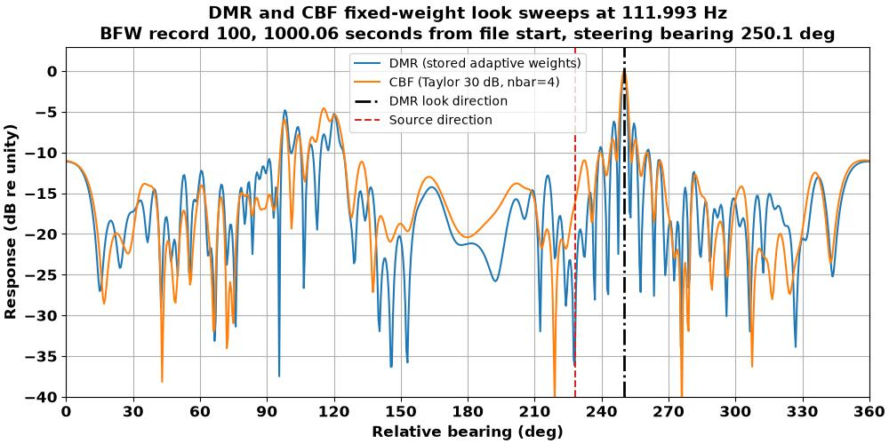
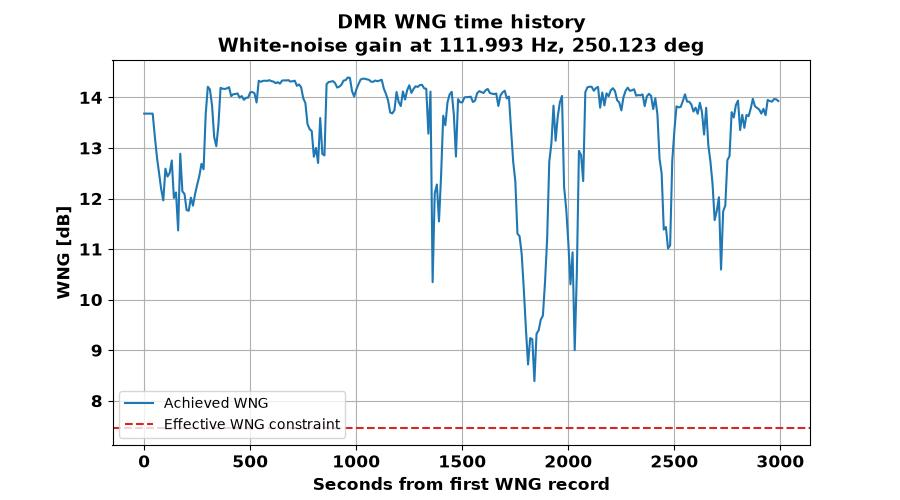
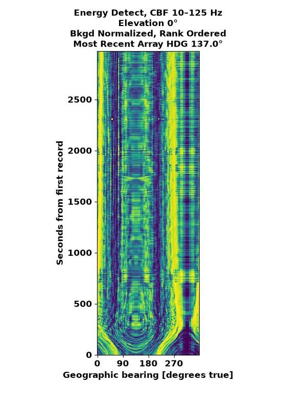
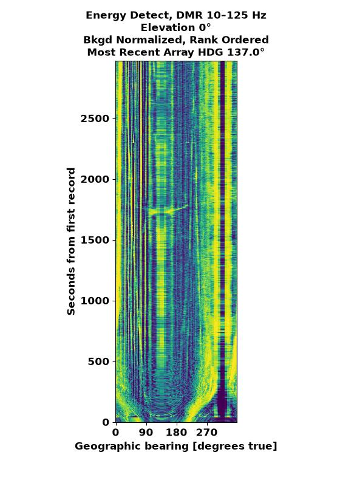

# Beamforming

WaveKernelRT currently implements frequency-domain conventional beamforming
(CBF) and element-space Dominant Mode Rejection (DMR). Both accept channel FFT
records and produce complex beam-frequency records:

```text
FFTBlock.data_QN (Q, N) -> beamformer -> BFBlock.data_QJ (Q, J)
```

The resulting `bfft` may be written directly, transformed back to beam time
series, or converted to `bpsd` for averaging and band-energy processing.

Geometry and replica construction are described in
[Geometry and steering](geometry-and-steering.md). Spatial weighting and
beampattern interpretation are described in
[Shading and beampatterns](shading-and-beampatterns.md).

## Inputs shared by CBF and DMR

Both configured stages require:

| Input | Shape | Meaning |
| --- | --- | --- |
| Channel spectrum | `(Q, N)` | Complex one-sided spectrum for `N` channels |
| `geom` | `Nsource` elements | Full geometry corresponding to original source channels |
| `steer_rbe_rad_J3` | `(J, 3)` | Range in meters; relative bearing and elevation in radians |
| `shading` | `ShadingConfig` | Uniform, Hamming, or Taylor spatial shading |
| Frequency grid | `(Q,)` | Inherited from the FFT input |

At least two input channels are required. The full geometry element count must
equal the original source-channel count. If `ChannelCropConfig` precedes the
beamformer, the builder selects the corresponding geometry elements and
recomputes the selected phase center and shading. Multidimensional selections
must remain complete row/column subsets.

Configured beamformers always interpret steering bearings relative to array
heading. Per-record heading values are output metadata and do not rotate the
steering grid or rebuild the weights. Line and panel arrays share one shading
vector across beams. Cylinders and spheres compute one visible-aperture vector
for each beam.

## Conventional beamforming

For input spectrum $x_{q,n}$, steering replica $a_{q,n,j}$, and shading
$s_{n,j}$, the normalized CBF multiplication weight is

$$
w_{q,n,j}
= \frac{s_{n,j}a^*_{q,n,j}}
       {\sum_n s_{n,j}a^*_{q,n,j}a_{q,n,j}}.
$$

The beam output is

$$
y_{q,j} = \sum_n x_{q,n}w_{q,n,j}.
$$

This convention stores the conjugation in the multiplication weight, so the
runtime sum does not apply another conjugate. The denominator gives unity
response to a replica matching the steering direction.

Configure the stage with `FFTtoCBFConfig`:

```python
from wavekernelrt.pipeline.configs import FFTtoCBFConfig, ShadingConfig

cbf_config = FFTtoCBFConfig(
    geom=geom,
    shading=ShadingConfig(
        window_type="taylor",
        sll_dB=30.0,
        nbar=4,
    ),
    steer_rbe_rad_J3=steer_rbe_rad_J3,
)
```

CBF is stateless: each input record produces one output record with the same
sequence number and `advance`.

## Dominant Mode Rejection

DMR is an adaptive beamformer that estimates the element-space cross-spectral
matrix (CSM), retains a bounded set of dominant eigenmodes, and applies loaded
inverse-covariance weights. WaveKernelRT's truncated, diagonally loaded
covariance and direction-dependent norm constraint most closely follow
[Cox et al. (2005)](../references.md#cox-et-al-2005), equations (20)–(23).
The complete source mapping is in
[Algorithm references](../references.md#implementation-mapping).

### Covariance startup and update

WaveKernelRT derives the reference training count from the configured maximum
retained rank `Dmax` and nominal loss target `sinr_loss_dB`. The policy starts
from the strong-interferer, matched-rank,
signal-free-training approximation in [Hulbert and Wage
(2022)](../references.md#hulbert-and-wage-2022), section V-C, equations
(72)–(73):

$$
\mathcal{L}
= \frac{\operatorname{SINR}_{\mathrm{DMR}}}
       {\operatorname{SINR}_{\mathrm{ensemble}}}
\approx 1 - \frac{R}{T}.
$$

For the configured nominal loss magnitude $\delta$ dB, rearranging the
approximation and substituting `Dmax` for $R$ gives

$$
T_{\mathrm{ref}} = \left\lceil
\frac{D_{\max}}{1-10^{-\delta/10}}
\right\rceil.
$$

The default `sinr_loss_dB=1.0` gives
$T_{\mathrm{ref}}=\lceil4.8621D_{\max}\rceil$; therefore `Dmax=10` gives 49
snapshots. Substituting `Dmax` for the true interference rank is an engineering
policy, not a result stated by the paper, and the nominal loss is not a
performance guarantee. In particular, [Hulbert and Wage
(2025)](../references.md#hulbert-and-wage-2025) shows that including the desired
signal in the training data changes SINR loss and can change the required
training support.

For the first $T_{\mathrm{ref}}$ records, the stage accumulates

$$
\widehat{R}_q
= \frac{1}{T_{\mathrm{ref}}}
  \sum_{t=1}^{T_{\mathrm{ref}}}x_{q,t}x^H_{q,t}
$$

while emitting CBF output. DMR begins on the following record. Thereafter, each
snapshot updates the CSM exponentially with

$$
\alpha = \frac{2}{T_{\mathrm{ref}}+1}, \qquad
\widehat{R}_q \leftarrow
(1-\alpha)\widehat{R}_q + \alpha x_qx_q^H.
$$

The completed startup estimate is the ordinary equal-weight sample covariance
in [Wage and Buck (2010)](../references.md#wage-and-buck-2010), equation (5),
and [Hulbert and Wage (2022)](../references.md#hulbert-and-wage-2022), equation
(5). For independent stationary covariance contributions, exponential weights
have variance-equivalent sample count

$$
T_{\mathrm{eff}} = \frac{2-\alpha}{\alpha}.
$$

The chosen $\alpha$ makes $T_{\mathrm{eff}}=T_{\mathrm{ref}}$, giving startup
and steady-state averaging a common statistical reference count. This
exponential moving average (EMA) mapping is a WaveKernelRT policy derived from
the exponential weights; it is not a DMR SINR theorem, and the EMA is not
identical to the finite equal-weight covariance analyzed in the cited papers.
Each frequency bin maintains and decomposes its own CSM.

### Dominant modes

The Hermitian CSM is decomposed with `numpy.linalg.eigh`, and eigenvalues are
ordered from largest to smallest and clipped nonnegative. Retaining the largest
eigenpairs follows the dominant-subspace constructions described by
[Cox et al. (2005)](../references.md#cox-et-al-2005), equation (23), and
[Hulbert and Wage (2022)](../references.md#hulbert-and-wage-2022), section
III-A.

The rank estimato/energy-fraction rule itself is local to WaveKernelRT. It finds the number of
modes required to reach `eig_thresh`, retains one additional mode as an
adaptivity margin, and clips the result to `[Dmin, Dmax]` and to the active
element count. In the implementation, one part of the `+2` converts the
zero-based threshold-crossing index to a mode count; only the remaining `+1`
adds a mode beyond the threshold count. [Campos Anchieta and Buck
(2022)](../references.md#campos-anchieta-and-buck-2022), section III, and
[Hulbert and Wage (2025)](../references.md#hulbert-and-wage-2025), section V,
support the general rationale for studying conservative rank
overestimation and document its costs.

For retained eigenvectors $U_D$ and eigenvalues $S_D$, DMR forms the loaded
inverse response corresponding to

$$
R_{loaded}^{-1}
= \left(U_D S_D U_D^H + \epsilon I\right)^{-1}
$$

and normalizes the resulting weight for unity response in the steering
direction. This is the single-steering-vector specialization of Cox et al.,
equation (22). The implementation evaluates the inverse action in the retained
subspace without constructing a full matrix inverse. Cox et al., equation (23),
uses a fixed noise-estimate load plus a separate norm-control load;
WaveKernelRT's $\epsilon$ is one searched total load.

### White-noise-gain constraint

For a unity-response weight vector, white-noise gain is

$$
\operatorname{WNG} = \frac{1}{w^H w},
$$

as in [Hulbert and Wage (2022)](../references.md#hulbert-and-wage-2022),
equation (7). WaveKernelRT evaluates this expression algebraically in the
retained covariance eigenbasis. The loading level $\epsilon$ is selected
separately for each beam by a bracketed search, consistent with the
direction-dependent loading discussed by Cox et al. `wngc_val_dB` states the
desired WNG relative to the unshaded CBF value; `wngc_tol_dB` lowers the minimum
accepted threshold by that tolerance. For example, `wngc_val_dB=-6` with
`wngc_tol_dB=1` tests against a threshold 7 dB below the unshaded CBF value.

Beams with the same active curved-array aperture are grouped so their shared
element CSM can be decomposed together. Every beam must have at least two active
elements.

### Inspecting adaptive weights

A DMR beampattern is associated with one data-dependent weight vector at a
particular time, frequency, and steering direction. To inspect that weight
vector, hold it fixed and sweep simulated signal-arrival directions with the
`BeamPattern` look-sweep evaluation. Sweeping a bank of DMR weights against one
fixed arrival instead compares the responses of the different adaptive beams.
See [Two beampattern sweeps](shading-and-beampatterns.md#two-beampattern-sweeps)
for the distinction and the conventional-beam equivalence case.



This SWellEx-96 Event S5 comparison uses the stored DMR weights at 111.993 Hz
and a Taylor-shaded CBF steered to the same 250.1-degree relative bearing. The
event contains a broadcast tone at 112 Hz on relative bearing 228 degrees.
Because that tone is near the DMR look direction, the adaptive weights reshape
the conventional beampattern and place a deep null at the tone bearing while
preserving unity response at the look direction. This is one time-, frequency-,
and beam-specific diagnostic, not a time-invariant DMR beampattern.

### DMR configuration

```python
from pathlib import Path

from wavekernelrt.pipeline.configs import DMRElementConfig, ShadingConfig

dmr_config = DMRElementConfig(
    geom=geom,
    shading=ShadingConfig(window_type="taylor", sll_dB=30.0, nbar=4),
    steer_rbe_rad_J3=steer_rbe_rad_J3,
    Dmin=3,
    Dmax=10,
    wngc_val_dB=-6.0,
    wngc_tol_dB=1.0,
    eig_thresh=0.9,
    sinr_loss_dB=1.0,
    write_weights=True,
    weight_band_Hz=(100.0, 800.0),
    weight_seq_stride=10,
    output_weight_file=Path("dmr_weights.bfw"),
    write_wng=True,
    wng_band_Hz=(100.0, 800.0),
    wng_seq_stride=10,
    output_wng_file=Path("dmr_wng.wng"),
)
```

Weight output is disabled by default. When enabled, the stage writes one QJN
record for every beamformed record, including the CBF records emitted during
covariance training. The optional inclusive frequency band limits only the
stored weights; it does not crop DMR processing or beam output. BFW records are
the already-conjugated multiplication coefficients, so loaded weights can be
applied directly with `np.einsum("qn,qjn->qj", data_QN, weights_QJN)`.

!!! warning "DMR diagnostic files can be extremely large"

    File size grows with stored time records, frequencies, beams, and channels.
    The SWellEx-96 Event S5 example has 2,998 output records, **Q = 3,278**
    one-sided frequency bins, **J = 200** beams, and 28 channels. Saving every
    complex64 DMR weight would require about **440 GB (410 GiB)** of payload,
    roughly 0.5 TB for capacity planning. The example therefore limits weight
    and WNG diagnostics to 90--115 Hz and stores every tenth sequence. That
    reduces the demonstrated BFW file to 50 frequency bins, 300 records, and
    about 672 MB. Adjust the frequency downselection and time stride before a
    long run; they affect diagnostic storage only, not DMR processing or beam
    output.

`output_weight_file` is optional. If omitted and the final output is BFFT or
BPSD, its suffix is replaced with `.bfw`; for example, `beams.bfft` becomes
`beams.bfw`. For other final products, the weight filename is
`<input-stem>_dmr.bfw` in the final output directory.

WNG output is an independent, default-off option with a dedicated `.wng` file
format. Each `(Q, J)` record stores dimensionless linear `1 / (w^H w)` for the
coefficients actually used. The header stores both `wngc_val_dB` and
`wngc_tol_dB`, along with the BF frequency, beam, shading, and timing metadata.
Convert the records to decibels with `10*np.log10(wng_QJ)`. `wng_band_Hz` and
`output_wng_file` follow the same band-selection and automatic-path rules as
weight output, using `.wng` and `<input-stem>_dmr.wng` names. For final
BFFT/BPSD output, the final suffix is replaced: `beams.bfft` becomes
`beams.wng`.

The independent sequence strides reduce temporal density and file size. A
stride of `10` stores DMR input sequences `0, 10, 20, ...`. Sidecar headers
multiply the spectral `advance` by ten and retain sequence zero's center time,
so the ordinary header timing formula reconstructs accurate timestamps.

### Inspecting WNG constraint enforcement

Run `example_visualization_dmr_wng.py` against a saved `.wng` sidecar to check
the achieved white-noise gain against the effective constraint. The first
image shows absolute WNG across stored frequency and relative bearing for one
time record. The second subtracts achieved WNG from the effective constraint:
negative values pass, positive values fail, and values are clipped to
$\pm10$ dB for display.

<table style="table-layout: fixed; width: 100%;">
  <thead>
    <tr>
      <th style="width: 50%;">Absolute WNG</th>
      <th style="width: 50%;">Constraint-relative diagnostic</th>
    </tr>
  </thead>
  <tbody>
    <tr>
      <td>
        
      </td>
      <td>
        
      </td>
    </tr>
  </tbody>
</table>

The line plot then follows one frequency and beam through the stored records.
For this Event S5 example, the selected point is 111.993 Hz and 250.123 degrees.
The request and tolerance produce a 7.447 dB effective absolute constraint;
the trace remains above that reference, so the displayed selection satisfies
the constraint throughout the saved history. Use the two snapshots to locate
frequency/bearing regions near the limit, then select one of those locations
for the time-history plot to determine whether a feature is persistent or
transient.

{: style="display: block; width: 100%; height: auto;" }

The exact validation rules for these fields are in the
[configuration reference](../reference/configuration.md#dmrelementconfig).

## Output normalization and downstream processing

CBF and DMR produce complex beam spectra, not power. `FFTtoPSDConfig` converts
them to one-sided beam PSD. PSD conversion, averaging, and band energy are
separate pipeline stages; beamforming itself does not convert to decibels or
apply temporal averaging.

### CBF and DMR bearing-time comparison

These SWellEx-96 examples hold the downstream processing constant: both use a
background estimate and ranked uint8 bearing-time output. This makes the
bearing-time structure produced from CBF and DMR easier to compare without
interpreting color as an absolute level.

| CBF | DMR |
| --- | --- |
|  |  |

These are products of the complete beamforming, PSD, background-estimation,
and band-energy chain rather than standalone beampatterns. See the
[full BTR comparison gallery](band-energy-detection.md#swellex-96-comparison-gallery)
for the float32, ranked, background-estimated, and direct-output combinations.
The background estimator's median and spectral clip-and-replace filters, and
their relationship to Hampel filtering, are documented under [optional
background normalization](band-energy-detection.md#optional-background-normalization).

Beam-frequency headers retain:

- the steering grid,
- shared or per-beam shading,
- the applied time-domain FFT window,
- frequency and timing metadata.

They do not currently identify whether the beam spectra came from CBF or DMR.
Record that provenance separately when it matters.

## Assumptions and limitations

- CBF and DMR use `float32` steering replicas in configured pipelines.
- No sensor calibration, gain matching, or propagation-loss model is applied
  by the beamformer.
- DMR covariance snapshots are not mean-subtracted.
- DMR emits CBF, not empty records, during covariance startup.
- Substituting `Dmax` for interference rank, the exponential covariance update,
  and the cumulative-energy rank estimator are implementation policies, not
  guarantees from the cited papers.
- `sinr_loss_dB` is a nominal design input. Its model assumes strong
  interferers, signal-free training, correctly specified rank, and an
  equal-weight covariance; it does not generally predict loss for
  signal-containing or nonstationary data.
- The extra retained mode is motivated only generally by literature on rank
  overestimation; the exact `+1` rule has not been derived or validated there.
- The batched loading search has finite iterations. If it cannot bracket a
  feasible white-noise-gain solution after its bounded expansion, processing
  continues and the requested constraint is not guaranteed.
- Achieved DMR white-noise gain can be emitted as WNG. Loading-search
  feasibility is not currently emitted as a separate diagnostic.
- The implementation is experimental and should be validated against known
  signals and expected beampatterns for each application.

The SWellEx-96 example configuration demonstrates complete CBF and DMR pipeline
placement; see the [SWellEx-96 workflow](../examples/swellex96.md).
